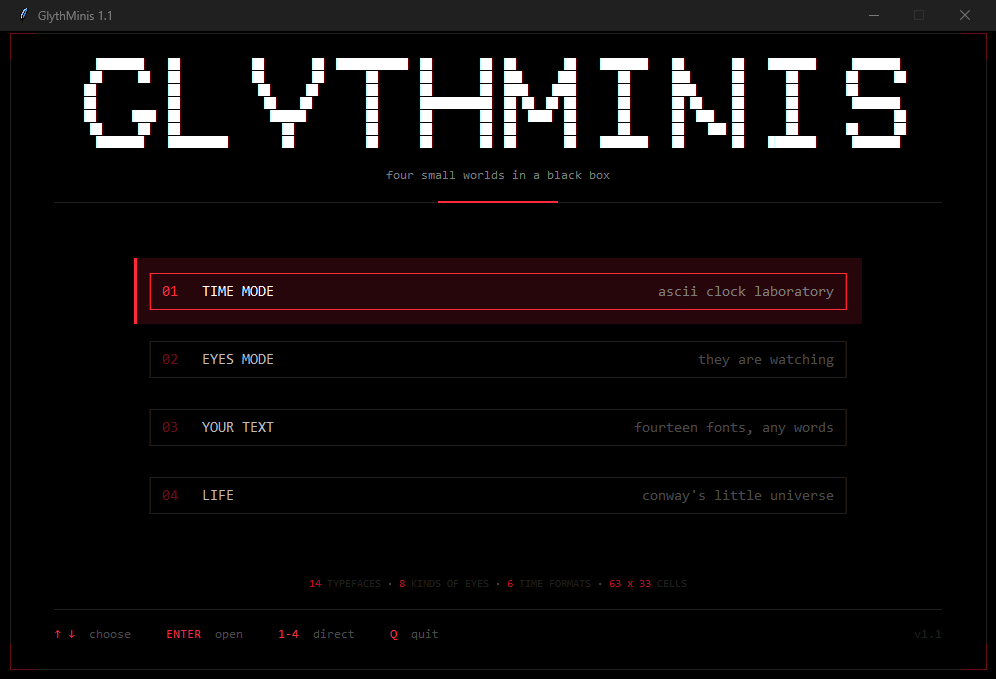
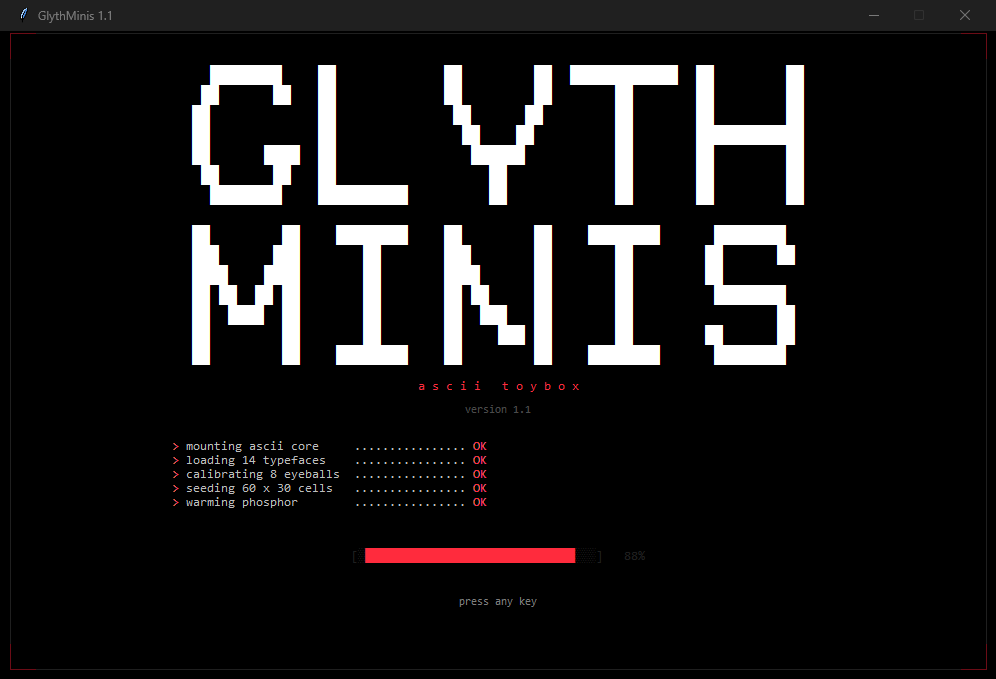
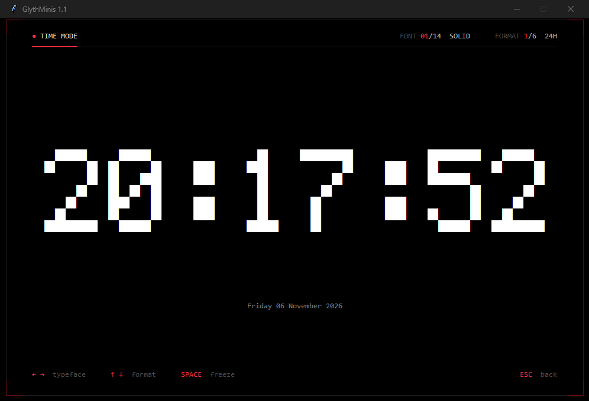
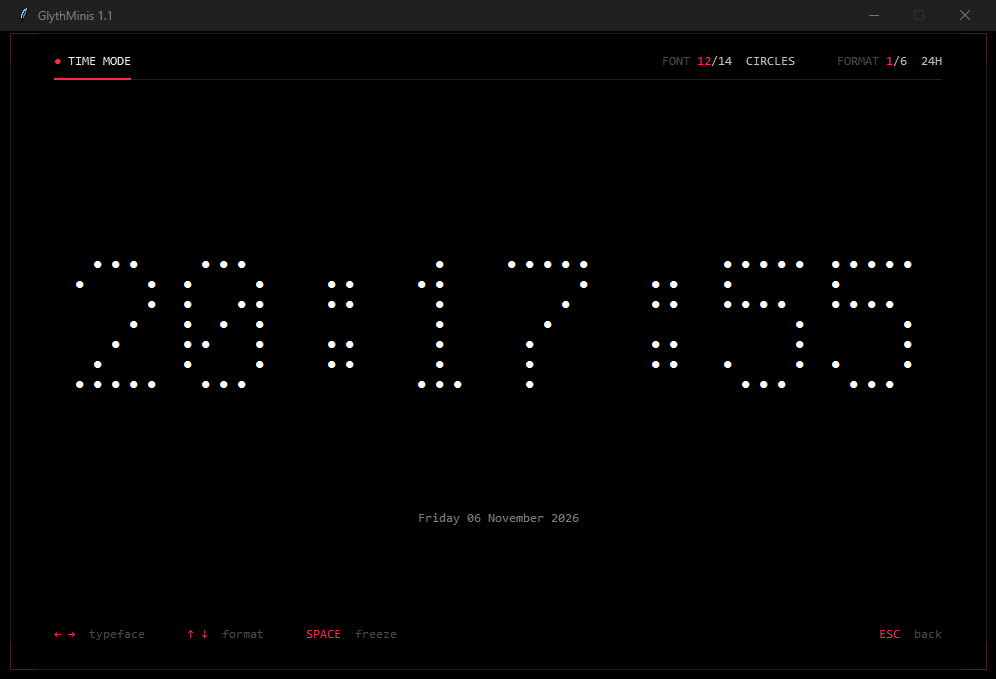
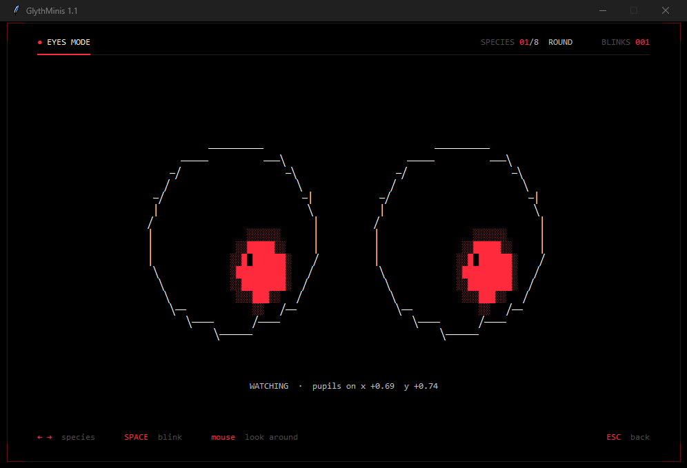
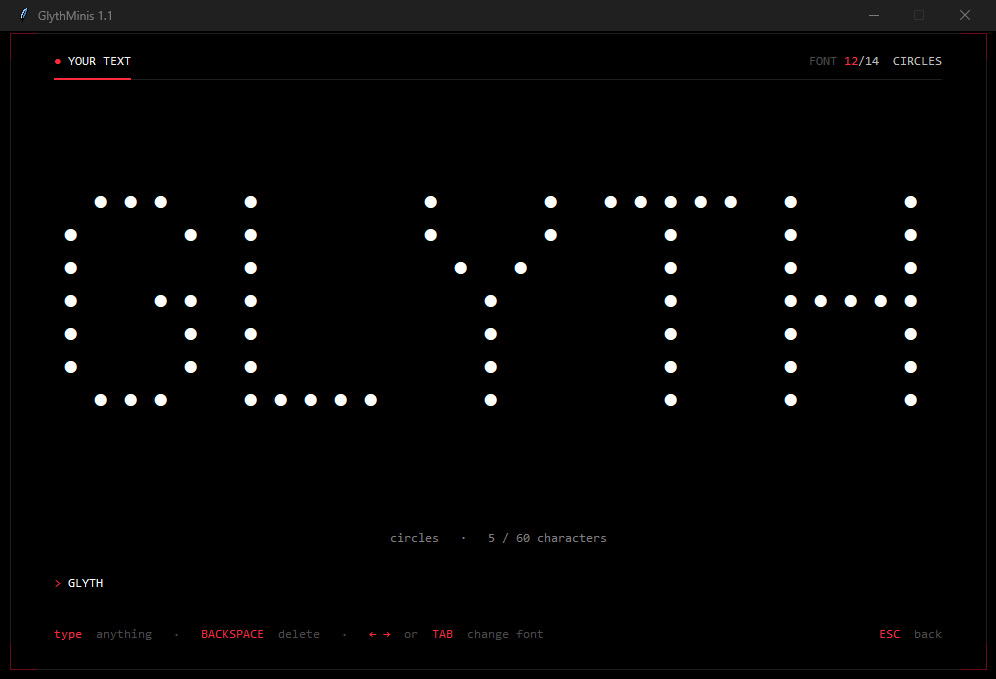
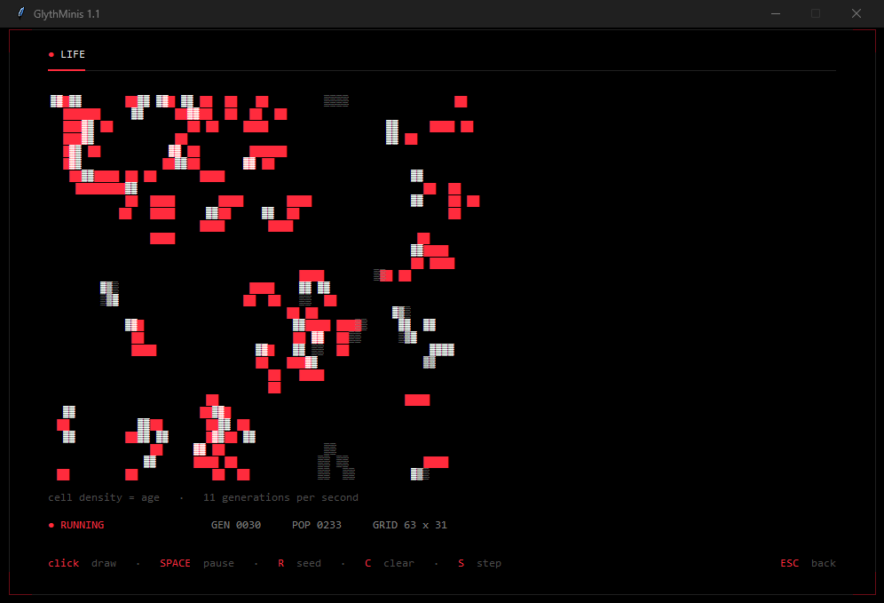

# GlythMinis

Маленькая чёрная коробка с четырьмя ASCII-игрушками. Всё — текст на одном
моноширинном шрифте: ни картинок, ни внешних библиотек.
Только Python 3 + tkinter (или готовый .exe).

Чёрное стекло, белые буквы, красный — только на акценты: активный пункт,
цифры, живая точка, новорождённые клетки.

**[Скачать GlythMinis 1.1 для Windows](https://github.com/vvixter84-jpg/GlythMinis/releases/latest)** —
zip, распаковать и запустить `GlythMinis.exe`, Python не нужен.



## Запуск

Двойной клик по **`run.bat`** — он сам найдёт Python (venv рядом → встроенный
рантайм DeepSeek Harness → `py -3` → `python`).

Или вручную:

```bat
python -m glythminis
```

Нужен Python 3.10+ с tkinter (стандартная сборка Python для Windows подходит).

### Готовый .exe (Python не нужен)

`dist\GlythMinis\GlythMinis.exe` — папку `GlythMinis` можно целиком перенести
куда угодно и запускать двойным кликом. Рядом лежит
`dist\GlythMinis-1.1-win64.zip` (11 МБ) — то же самое одним архивом.

Сборка сделана папкой, а не одним файлом, намеренно: one-file вариант при
каждом старте распаковывает DLL в `%TEMP%`, а антивирус / ASR на этой машине
такую распаковку блокирует (пустое окно «Error»). Папочная сборка ничего не
распаковывает и стартует мгновенно.

Пересобрать: `powershell -ExecutionPolicy Bypass -File build_exe.ps1`
(иконка `res\glythminis.ico` рисуется из того же 5×7 битмапа скриптом
`tools\make_icon.py`).

## Что внутри

Загрузочный экран с ASCII-логотипом, прогресс-баром и списком инициализации,
потом меню с четырьмя кнопками. Кнопки можно выбирать стрелками и `ENTER`,
кликать мышью или открывать цифрами `1`–`4`.



### 01 · TIME MODE — ASCII-часы

14 начертаний × 6 форматов, всё считается в реальном времени.



Часы круглым шрифтом:



| клавиша | действие |
| --- | --- |
| `←` / `→` | начертание (14 шрифтов) |
| `↑` / `↓` | формат |
| `SPACE` | заморозить время |
| `ESC` | назад в меню |

Форматы: `24H` · `24H SHORT` · `12H` · `DATE` · `EPOCH` · `WORDS`
(«SIX / FIFTY» — время словами).

### 02 · EYES MODE — глаза



8 видов глаз, нарисованных процедурно: эллипс-обводка, зрачок, радужка, веко.
Глаза моргают (иногда дважды подряд) и следят зрачками за мышью, а если мышь
уснула — начинают лениво оглядываться сами.

| клавиша | действие |
| --- | --- |
| `←` / `→` | вид глаз |
| `SPACE` | моргнуть вручную |
| `ESC` | назад |

Виды: `ROUND` · `WIDE` · `SLEEPY` · `ANGRY` · `CAT` · `ROBOT` · `LOVE` · `DIZZY`.

### 03 · YOUR TEXT — любой текст



Печатайте что угодно (латиница, кириллица, цифры, знаки) — текст тут же
рендерится в выбранном ASCII-шрифте и масштабируется так, чтобы занять почти всё
окно. Длинные фразы автоматически переносятся на 2–4 строки и подбирается
самый крупный кегль.

| клавиша | действие |
| --- | --- |
| любые символы | добавить |
| `BACKSPACE` | удалить |
| `←` / `→` / `TAB` | сменить шрифт |
| `ESC` | назад |

### 04 · LIFE — игра «Жизнь» Конвея



Сетка 63×33, клетки рисуются блоками. Чем старше клетка, тем «прозрачнее»
символ (`█ → ▓ → ▒ → ░`) — по картинке видно историю колонии.

| действие | |
| --- | --- |
| клик / протяжка мышью | рисовать и стирать клетки |
| `SPACE` | пауза |
| `R` | заново засеять |
| `C` | очистить |
| `S` | один шаг |
| `ESC` | назад |

## Четырнадцать шрифтов

Все начертания — это один и тот же битмап 5×7, отрисованный по-разному:

`SOLID` · `FAT` · `SCAN` · `OUTLINE` · `SHADOW` · `GRADIENT` · `HATCH` · `AT` ·
`STAR` · `SHADE` · `DOTS` · **`CIRCLES`** · **`RINGS`** · `PLUS`

`CIRCLES` и `RINGS` — те самые круги: каждая точка буквы становится кружком
`●` или колечком `○`, получается LED-матрица.

## Как это устроено

* `glythminis/glyphs.py` — шрифт 5×7 (A–Z, 0–9, пунктуация, кириллица) и
  движок начертаний: заливка, контур, тень, градиент, масштаб по горизонтали
  и вертикали. Там же отдельная широкая гарнитура 12×7 для логотипа: у 5×7
  буквы в баннере превращаются в узкий трафарет, а 12×7 даёт нормальные
  G, S и симметричную M.
* `glythminis/eyes.py` — процедурные глаза: эллипс трассируется по периметру,
  символ выбирается по направлению шага (поэтому контур не рассыпается на
  пунктир), веко обрезает эллипс по «приоткрытости», зрачок — залитый эллипс
  внутри.
* `glythminis/app.py` — экраны, таймеры, ввод; один `Canvas` и один моноширинный
  шрифт, каждая картинка — многострочный `text item`.

## Флаги для разработки

```bat
python -m glythminis --screen eyes --eye 6
python -m glythminis --screen time --format 6 --style 4
python -m glythminis --screen text --text PRIVET --style 5
```

`--screen menu|time|eyes|text|life` пропускает загрузку, `--style`, `--format`,
`--eye`, `--text` задают стартовое состояние.

## Инструменты

`tools/` — служебные скрипты, для игры не нужны: `ui_test.py` (70 проверок
логики и раскладки без ручного тыканья), `shot.ps1` (снимок окна через
PrintWindow), `probe_font.py`, `probe_eyes.py`, `probe_frames.py` (отладка
глифов и глаз в консоли и на канве), `make_icon.py` (иконка из битмапа).
`build_exe.ps1` в корне — сборка `dist\GlythMinis\`.
